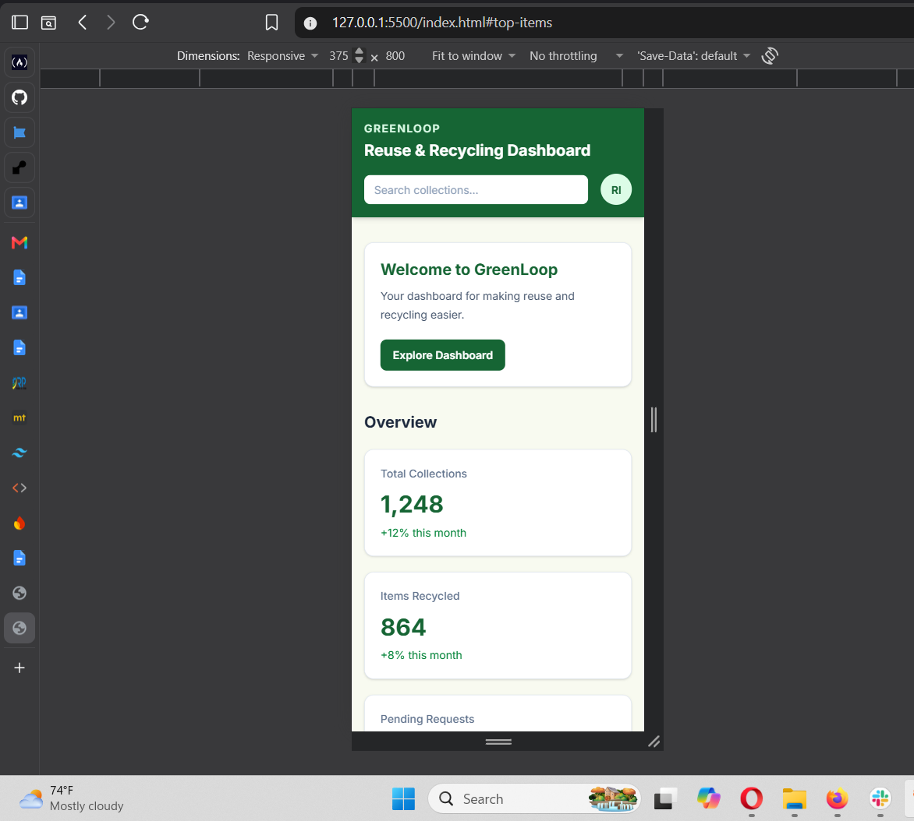
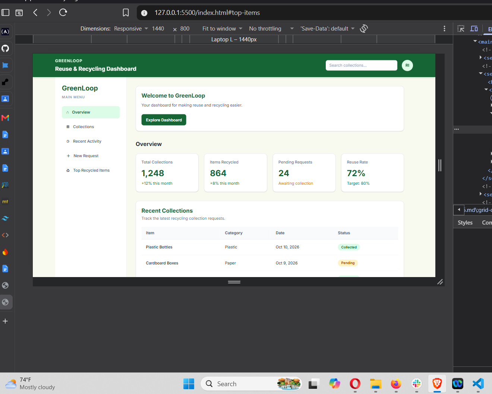

# GreenLoop — Reuse & Recycling Dashboard

**Live Website:** [Open GreenLoop Dashboard](https://week3-tailwind-dashboard.onrender.com)

## About the Project

GreenLoop is a responsive dashboard for presenting reuse and recycling information. It displays collection statistics, collection records, recent activity, popular recycled materials, and a collection request form.

## Features

- Responsive sidebar navigation
- Dashboard statistics cards
- Collection table with status badges
- Recent Activity and Top Recycled Items panels
- Collection request form
- Search field and profile avatar
- Responsive layouts for mobile, tablet, and desktop

## Technologies Used

- HTML5
- Tailwind CSS v4
- Tailwind CSS CLI
- Google Fonts (Inter)
- Git and GitHub Pages

## How to Run Locally

1. Clone this repository:

   ```bash
   git clone https://github.com/rithairagena13-spec/week3-tailwind-dashboard.git
   ```

2. Open the project folder:

   ```bash
   cd week3-tailwind-dashboard
   ```

3. Install dependencies:

   ```bash
   npm install
   ```

4. Build the CSS:

   ```bash
   npm run build
   ```

5. Open `index.html` in your browser or use the Live Server extension in VS Code.

## How I Customized Tailwind

I customized Tailwind CSS v4 using the `@theme` directive in `src/input.css`. I defined forest green, leaf green, cream, and mint colors to create a consistent recycling-inspired design. I also configured Inter as the main font for a clean and readable interface.

I created reusable component classes in `@layer components` using `@apply`. The `.dashboard-card` class styles dashboard panels, `.btn-primary` styles primary buttons, and `.status-badge` styles collection status labels. I used responsive utility classes to adapt the layout to different screen sizes and hover, focus, and transition utilities to improve usability.

## Screenshots

### Mobile View — 375px



### Desktop View — 1440px



## Deployment

The project is deployed using Render.

**Live Website:** [Open GreenLoop Dashboard](https://week3-tailwind-dashboard.onrender.com)

## Repository

[View the GitHub repository](https://github.com/rithairagena13-spec/week3-tailwind-dashboard)

## Author

Ritha IRAGENA